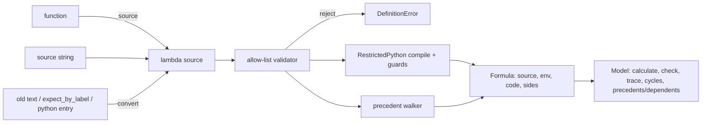

# feat: One kind of formula — checked lambdas run with RestrictedPython, with a static dependency graph

## Summary

Every formula and check becomes one thing: a lambda of `x`, given as a function or as source text, checked against an allow-list, and run through RestrictedPython.
A static pass over the lambda's AST gives every cell's precedents before anything is calculated, and a public API exposes the precedents and dependents of any cell.
The `Expr` operator-overloading style (`m["a"] * 0.6`), the expression-text grammar and `allow_code` go away; saved files in the old formats convert on load.

## Problem Frame

tracemodel has two formula kinds today (`src/tracemodel/expr.py`, `src/tracemodel/cellfn.py`):

- An `Expr` is safe to load and has static dependencies, but can't express `if`, `max`, `x.coords`, `x.period` or hierarchy rollups.
- A `CellFunction` can express anything, but is saved as Python, loaded with `exec` behind `allow_code=True`, and has no static dependencies.

A lambda is probed once with a symbolic `x` to decide its kind, so adding one token (`x.period`) silently changes how a formula loads and whether its cycles are checked.
Check functions add a third convention (`lambda sales_category: ...` called per label at definition time, building `Expr` trees from closures).
Designers have to know which mode they are in; models written by the modeler subagent can't use the time-spine features and still load without code.

---

## Requirements

**One formula kind**

- R1. Item formulas, cell formulas (`set_value(value=...)`) and checks all accept a lambda of one parameter (the cell, conventionally `x`), passed as a function or as its source string.
- R2. The same validated code runs in the session and after load; the user's original function object is never called.
- R3. Every feature reachable today stays expressible: arithmetic, comparisons (chained too), `and`/`or`/`not`, `a if c else b`, `abs`/`max`/`min`/`round`/`sum`, `x["item"]`, `["label"]`, `.sel`, `.lag`, `.lead`, `.shift`, `.is_nil`, `x.coords`, `x.attrs`, `x.period(s)`, `.dt`, dates and timedeltas, and comprehensions over labels.
- R4. Hierarchy rollup checks are expressible as `lambda x: ...` through `x.children(dim)` / `x.parent(dim)`, and cover labels added later.

**Safety**

- R5. Loading any model or values file never executes code outside the allow-list, with no `allow_code` flag.
- R6. Formulas can't reach private attributes, dunders, the model object, imports, I/O, or names outside an explicit builtins set.
- R7. Formulas that would build huge numbers or strings (`9**9**9`, `"a" * 10**10`) are rejected or bounded rather than hanging the process.

**Dependencies**

- R8. Every formula cell has a static precedent set (cells it can read), computed without reading values; both arms of a value-dependent branch count.
- R9. Cycle detection and definition-time errors (unknown item, dim left open, label out of range) work for every formula, as they do today for `Expr`.
- R10. A public API returns a cell's precedents and dependents, one level or as a full tree.
- R11. A read whose item or labels depend on a cell value is rejected at definition time.

**Compatibility and parity**

- R12. Existing saved files load: expression-text formulas and checks, `expect_by_label` checks, `{"python": ...}` formulas, and text cell formulas in values files.
- R13. Check results keep `lhs`/`rhs`/`diff` for a top-level comparison and the inputs read by failing runs; Excel highlighting and `Report.explain` keep working.
- R14. Full calculation and incremental recalculation are no slower than today on the 1,000-line × 60-month benchmark.

---

## Scope Boundaries

- Building or documenting the gVisor sandbox deployment — tracked in issue #7.
- 52/53-week fiscal years — issue #6.
- `def` formulas with statements. They are rejected with a message pointing to lambdas; they were never savable.
- Renaming items or relaxing the item-name identifier rule.

### Deferred to Follow-Up Work

- Exporting live Excel formulas from the formula AST.
- A graph export format (DOT/JSON) on top of the precedents/dependents API.
- Updating `scripts/modeler_agent.sh` prompts beyond the formula syntax change in `docs/agents.md`.

---

## Key Technical Decisions

- **Source text is the formula.** A function is turned into its lambda source (existing `_function_source` in `src/tracemodel/cellfn.py`), then treated exactly like a source string. This gives R2 and keeps one code path from definition to load.
- **Our allow-list runs first, RestrictedPython second.** An AST validator accepts only the R3 subset; RestrictedPython then compiles it and routes every attribute, `[]` and iteration through our guards. RestrictedPython's own `safe_globals` is not used: it exposes `setattr`, `delattr`, `id`, `isinstance` and `__build_class__`.
- **Attribute access is allow-listed per type, deny by default.** The guard looks up the exact `type()` of the object (no `isinstance`, so subclasses don't inherit access) in a table covering the cell object, `Period`, `date`, `datetime`, `timedelta`, `DatetimeAccessor`, `str`, `list`, `dict`, `float`, `int` and the `math` module; a type not in the table, a name not listed for it, and any `_` name all raise.
- **Comparisons keep today's rules.** Every `Compare` node is rewritten to call one helper that reuses `Comparison.allows` from `src/tracemodel/expr.py`: about 1e-9 of float slack, and a date never compares with a number. Without this, the ~420 saved checks of the form `abs(a - b) <= 0.2` flip on rounding.
- **Size bounds are checked at run time.** `*` and `**` compile to guarded helpers that refuse a result over a size limit (string or list repetition, integer exponent), and `range` is capped. The source-level constant-exponent rule is dropped, so `(1 + g) ** n` keeps working.
- **Closure values are snapshotted as data.** Allowed: numbers, strings, lists and dicts of them, dates, and the `math` module. The model, cells and hierarchies are refused; `x` already reaches them safely. On load, env entries are checked again: names must be identifiers that don't start with `_` and don't shadow a builtin or a guard, and values must be of the allowed types. Old `$model` / `$expr` entries raise a clear error naming the formula.
- **Static precedents come from abstract evaluation, per cell.** A walker evaluates label-only sub-expressions concretely for the cell (constants, closure values, `x.coords`, `x.attrs`, `x.children`, `x.labels`, `x.period`), records each cell read, treats value results as unknown, and follows both arms of a branch on an unknown; a comprehension filter on an unknown counts as a branch (the element is kept). A read whose item or labels are unknown is a definition error (R11). The walker uses the same attribute guard, size bounds and builtins as the compiled code, plus a step budget, so a hostile file can't hang or escape through it.
- **Precedents are computed lazily, and per formula where possible.** Each formula is walked once into a template of reads relative to the cell; only reads whose item or labels depend on the cell's labels (`x.children`, `x.coords` branches, attrs) are re-resolved per cell. Results are cached and invalidated by `_changed()`; `set_value` drops the cached precedents of the cell it touches. Dependents are the reverse index built from them.
- **Value-dependent dependencies stay exact at run time.** The existing `_dependents` tracing and `_warm` ordering in `src/tracemodel/model.py` keep driving calculation and incremental recalculation; static precedents drive cycle checks, validation and the public API. This keeps R14: a full calculation does no extra walks. The two mechanisms answer different questions (what can be read vs what was read), so both stay.
- **Item names are checked at commit, not at add.** Inside a transaction, unknown items and cycles are checked when it commits, so formulas can read items added later in the same transaction; `from_dict` loads inside one transaction so saved order doesn't matter. Outside a transaction they are checked at `add_item`.
- **A check is a value check.** `expect=lambda x: ...` runs once per run with `x` at the run's coords. Per-label builder functions (`lambda sales_category: ...`) and `expect_by_label` storage go; a top-level `Compare` in the AST gives `lhs`/`rhs`/`diff`, and a top-level `and`/`or` gives the parts.
- **`m["item"]` stays as a read-only selector.** Indexing, `.sel`, `.lag` and table display in Jupyter keep working; arithmetic and comparisons on it raise a `DefinitionError` pointing to lambdas. `model.evaluate` takes a lambda and infers the dims from its static reads.
- **Old formats convert on load through one AST rewrite.** Item names become `x["name"]`, `~` becomes `not`, and `|`/`&` become `any([...])`/`all([...])` (not `or`/`and`, so a missing cell still fails the check instead of short-circuiting past it); the result is wrapped in `lambda x:`. An `expect_by_label` check becomes one lambda choosing per label. `allow_code` is accepted and ignored with a `DeprecationWarning`.
- **Untrusted files can skip formulas entirely.** `tm.load(..., formulas="off")` loads dimensions, items and values with formulas kept as text but not compiled or run. The README says files from untrusted sources belong in the sandbox from issue #7; RestrictedPython is one barrier, not the whole defence.
- **Dependency `RestrictedPython>=8,<9`.** It compiles to bytecode, so formulas run at plain-lambda speed (spike: 1.5–6.8 µs vs 1.8–6.4 µs per call).

---

## High-Level Technical Design

From formula to running code, at definition and at load:



The precedent walker, sketched (directional; names are not final):

```
walk(node, cell):
  constant / closure name           -> known value
  x.coords / x.attrs / x.children / x.parent / x.period -> known, from cell labels
  x["item"], ["label"], .sel/.lag/.lead/.shift -> a reference; resolve against cell
                                       (unknown key -> DefinitionError)
  a value read (reference used as a number) -> record cell; result unknown
  a if test else b                  -> test known: walk the chosen arm; else walk both
  comprehension                     -> iterable must be known; walk body per element
  any op on an unknown              -> unknown
```

---

## Implementation Units

### U1. Formula core: validate, compile, run

**Goal:** A `Formula` object built from a function or source string, validated against the allow-list and compiled with RestrictedPython.

**Requirements:** R1, R2, R5, R6, R7

**Dependencies:** none

**Files:**
- Create: `src/tracemodel/formula.py`
- Modify: `pyproject.toml`, `uv.lock` (add `RestrictedPython>=8,<9`)
- Test: `tests/test_formula.py`

**Approach:**
- Source capture reuses `_function_source`; closure and default-argument capture reuse `_env_value` / `_default_names` from `src/tracemodel/cellfn.py`, narrowed per the closure-value KTD.
- The validator walks the AST once and rejects: statements, `def`, `lambda` inside the body, imports, `_` names and attributes, starred args, walrus, `await`/`yield`, f-string format specs that reach attributes, and calls to names outside the builtins set.
- `*` and `**` become guarded helper calls bounded at run time; `range` is capped; huge integer literals and string `%` formatting are rejected (R7).
- `Compare` nodes (chained too) become calls to the comparison helper (see KTD).
- Guards: `_getattr_` (exact-type allow-list, deny by default), `_getitem_`, `_getiter_`; minimal builtins (`abs`, `max`, `min`, `round`, `sum`, `any`, `all`, `len`, `int`, `float`, `bool`, `range`, `date`, `datetime`, `timedelta`, `True`/`False`/`None`).
- Env entries are validated on construction and on load (names and value types).
- `tests/test_formula_security.py` starts here with the five spike escapes, so later units add to it rather than create it at the end.

**Patterns to follow:** `src/tracemodel/text.py` reader (node-by-node allow-list, error messages naming the formula text).

**Test scenarios:**
- Happy path: `lambda x: x["fee"] * x.period.overlap(x["start"], x["end"])` from a function and from a string gives the same source and the same value.
- Happy path: chained comparison, `if/else`, `max`, `sum(... for c in x.children("line"))` compile.
- Error path: each escape from the spike (`x.__class__`, `x._model`, `"{0._model}".format(x)`, `x.period.overlap.__globals__`, `__import__("os")`) raises `DefinitionError` at validation, before compile.
- Error path: `getattr(x, "_model")`, `setattr`, `type(x)`, `[].__class__`, a nested lambda, a walrus, `9**9**9`, `"a" * 10**10` are rejected.
- Error path: a closure over the model, a cell (`m["a"]`) or a hierarchy is refused with a message saying to use `x`.
- Error path: `[0] * 10**9`, `"a" * 10**10`, `2 ** 10**6` and `sum(range(10**12))` raise quickly; `(1 + 0.05) ** 12` and `x["base"] * 1.03 ** n` work.
- Error path: an env entry named `_getattr_` or `max`, or holding a function, is refused.
- Happy path: `abs(391_035.2 - 391_035) <= 0.2` passes (float slack), mirroring `test_dq1_tolerance_is_inclusive`; a date compared with a number raises as today.
- Happy path: `math.log(x["a"])` works; `math.__loader__` and an unlisted type's attribute are refused.
- Error path: a `def` formula raises with a message suggesting a lambda; a lambda with two required parameters raises.
- Edge: a lambda whose source isn't available raises and suggests passing the source string.
- Edge: two lambdas on one line still resolve to the right source (existing behavior).

**Verification:** every lambda in the current test suite validates and compiles; all spike escapes are blocked.

---

### U10. Old-format converter

**Goal:** Turn every old saved form into lambda source, as a pure function with no model dependency, so model integration can use it.

**Requirements:** R12

**Dependencies:** U1

**Files:**
- Create: `src/tracemodel/convert.py`
- Test: `tests/test_convert.py`

**Approach:**
- Rewrites expression text by AST: item `Name` → `x["name"]`, `~` → `not`, `|`/`&` → `any([...])`/`all([...])`, `date(...)` kept, wrapped in `lambda x:`.
- `expect_by_label` → one lambda with the per-label bodies keyed on `x.coords`.
- `{"python": ...}` entries pass through as source and are validated like any formula.
- An `Expr` or `Condition` object converts through its repr, so model integration can accept them while tests migrate.

**Test scenarios:**
- Happy path: `"revenue * 0.6"` → `lambda x: x["revenue"] * 0.6`; `"(a >= 0) & ~b.is_nil()"` → `all([...])`/`not`, evaluating the same.
- Happy path: an `expect_by_label` dict with three labels converts and gives each label's result.
- Edge: `(a > 0) | b.is_nil()` with `a` missing still fails, as today.
- Error path: text with `__import__` or an attribute outside the grammar is rejected.

**Verification:** every text formula and check in `runs/` converts and validates.

---

### U2. One `x` for formulas and checks

**Goal:** A single cell object for item formulas, cell formulas and checks, with hierarchy navigation.

**Requirements:** R3, R4

**Dependencies:** U1

**Files:**
- Modify: `src/tracemodel/cellfn.py` (fold `CheckX` into `Bound`), `src/tracemodel/dimensions.py`
- Test: `tests/test_formula.py`

**Approach:**
- A check run's `x` is the cell object at the run's coords with no item of its own; `x["item"]`, `.sel` and labels work as in formulas, and reading `x` itself as a number is an error.
- Add `x.children(dim)` and `x.parent(dim)`, returning labels from the dimension's hierarchy for the cell's label on `dim`, and `x.labels(dim)` for all of a dimension's labels (for dims without a hierarchy).
- The per-type attribute allow-list for U1's guard is declared next to each class it covers.

**Patterns to follow:** `Bound` in `src/tracemodel/cellfn.py`; `Hierarchy.children` in `src/tracemodel/dimensions.py`.

**Test scenarios:**
- Happy path: `lambda x: abs(x["net_sales"] - sum(x["net_sales"].sel(sales_category=c) for c in x.children("sales_category"))) <= 0.2` passes and fails as the current `NS-SUM` check does (`tests/test_apple.py` NS-SUM test).
- Happy path: adding a child label with `add_coords` is covered by the rollup check without redefining it.
- Error path: `x.children("period")` on a dim without a hierarchy, and on a dim the run doesn't have, raise with the dim named.
- Edge: `x.children` on a leaf returns `[]`, so `sum` is 0.

**Verification:** every current value check and params check has a lambda-of-`x` equivalent passing the same assertions.

---

### U3. Static precedents

**Goal:** For any formula cell, the set of cells it can read, computed from the AST without values.

**Requirements:** R8, R11

**Dependencies:** U1, U2

**Execution note:** measure before building on it. On the 1,000 × 60 benchmark, time the walker for all cells (template + per-cell re-resolution). If precedents for the whole model take more than about one full calculation, stop and revisit before U4.

**Files:**
- Create: `src/tracemodel/deps.py`
- Test: `tests/test_deps.py`

**Approach:**
- Implements the walker in the High-Level Technical Design; reuses `Cell.resolve` and `OutOfRange` from `src/tracemodel/expr.py` (moved if `expr.py` is removed in U8).
- Returns resolved cell keys `(item, labels)`, and separately the reads that fell out of range (for definition-time errors), and the free dims for `model.evaluate`.
- A formula that reads `x` itself (its own value) is a self-reference error, as today.

**Test scenarios:**
- Happy path: `x["revenue"] * 0.6` at `month=2026-03` → `{revenue[2026-03]}`.
- Happy path: `x.lag("period")` → previous period; at the first period → out of range (not a precedent).
- Happy path: `x["a"] if x["flag"] else x["b"]` → `{flag, a, b}`.
- Happy path: `x["a"] if x.coords["region"] == "east" else x["b"]` → only `a` at east, only `b` elsewhere.
- Happy path: the rollup check at `/products` → itself plus its four children.
- Happy path: `x["fee"] * x.period.overlap(x["start"], x["end"])` → `{fee, start, end}`.
- Error path: `x[x["which"]]` and `x.lag("period", x["n"])` raise "depends on a value".
- Error path: a formula with `range(10**12)` in a comprehension stops at the step budget with a `DefinitionError`.
- Happy path: `sum(x["a"].sel(line=c) for c in x.labels("line") if x["on"].sel(line=c))` → every `a` and `on` cell.
- Edge: comprehension over `x.attrs("line")["parts"]` (a list attr) walks each element.

**Verification:** for every formula in the test suite, the static precedents are a superset of the reads recorded at run time.

---

### U4. Model integration

**Goal:** `add_item`, `set_value`, `add_check`, calculation, cycle checks, tracing and check results all use `Formula`, with no `Expr`/`CellFunction` branches left.

**Requirements:** R1, R8, R9, R13, R14

**Dependencies:** U1, U10, U2, U3

**Files:**
- Modify: `src/tracemodel/model.py`, `src/tracemodel/values.py`, `src/tracemodel/cellfn.py`
- Test: `tests/test_apple.py`, `tests/test_recalc.py`, `tests/test_dates.py`, `tests/test_periods.py`

**Approach:**
- During this unit, an `Expr` or `Condition` passed in is converted through U10, so the existing tests keep running while they are migrated.
- `_check_cycles`, `_install_check` and `_reads` use static precedents for every formula; `_warm`, the `_Defer` path and `_deps` stay on run-time reads.
- Unknown items and cycles are checked at transaction commit inside a transaction (see KTD).
- `model.evaluate(lambda x: ...)` without coords walks the formula with no cell to find its free dims, then evaluates over them.
- `add_check` drops the params branch and `_ByLabel`/`_reexpand`; `_run` uses the formula's compiled sides for `lhs`/`rhs`/`diff`.
- `model.evaluate` and `Model.table` take a lambda and infer dims from U3.

**Execution note:** migrate tests file by file, keeping the full suite green after each file.

**Patterns to follow:** existing incremental-recalc bookkeeping (`_dependents`, `_runs`, `_run_dependents`) in `src/tracemodel/model.py`.

**Test scenarios:**
- Integration: a cycle through a lambda formula (`a = x["b"]`, `b = x["a"] if x["flag"] else 0`) is rejected at `add_item`; today it is only caught at calculation.
- Integration: an unknown item name in a lambda raises at `add_item`, not at first `get`; inside a transaction it raises at commit, and a forward reference to an item added later in the transaction works.
- Integration: a failing `abs(x["a"] - x["b"]) <= 1` check reports `lhs`, `rhs` and `diff`; a value check with `and` reports its parts.
- Integration: the 300-random-edit test in `tests/test_recalc.py` still matches a fresh model.
- Integration: a cell formula set via `set_value(value="lambda x: ...")` overrides the item formula and shows in `entry()`.
- Edge: a self-named lambda (`lambda revenue: revenue.lag("period") * 1.03`) keeps working.

**Verification:** no `isinstance(..., Expr | CellFunction | Condition)` branches remain in `src/tracemodel/model.py`; the full suite passes.

---

### U5. Save, load and old-format conversion

**Goal:** One saved form for all formulas and checks, and loading of every old form without `allow_code`.

**Requirements:** R5, R12

**Dependencies:** U10, U4

**Files:**
- Modify: `src/tracemodel/model.py` (`from_dict`, `load_jsonl`, `_formula_data`, `_check_data`), `src/tracemodel/__init__.py` (`load`)
- Test: `tests/test_convert.py`, `tests/test_apple.py` (save/load tests)

**Approach:**
- Saved form: `"formula": "lambda x: ..."`, with `"env"` only when closure values exist.
- Old forms go through U10; `from_dict` loads inside a transaction.
- A `{"python": ...}` entry is validated like any source; one that fails the allow-list raises naming the construct.
- `allow_code=` is accepted and ignored with a `DeprecationWarning`; `formulas="off"` keeps formula text without compiling it.

**Test scenarios:**
- Happy path: each of `runs/2026-10-11-define/model.json`, `runs/2026-10-11-define-2/model.json` and `runs/2026-10-11-forecast/forecast.model.json` (with its values file) loads, and `check()` gives the same pass/fail per run as before the change.
- Happy path: save → load → save is byte-identical for a model with lambdas, closures and dates.
- Happy path: a model whose saved item order has a formula before the item it reads loads.
- Happy path: `tm.load(path, formulas="off")` loads values and leaves formula cells uncalculated, with the text visible in `entry()`.
- Error path: a values-file formula `"__import__('os').system('x')"` is rejected at load; nothing runs.
- Error path: a `{"python": "lambda x: x._model"}` entry is rejected at load.
- Edge: `tm.load(path, allow_code=True)` warns and loads.

**Verification:** every saved file in `runs/` loads without `allow_code` and checks as before.

---

### U6. Public precedents and dependents

**Goal:** Ask what any cell reads and what reads it, one level or as a tree.

**Requirements:** R10

**Dependencies:** U3, U4

**Files:**
- Modify: `src/tracemodel/model.py`, `README.md`
- Test: `tests/test_deps.py`

**Approach:**
- `model.precedents(item, **coords)` and `model.dependents(item, **coords)`, named after Excel's Trace Precedents / Trace Dependents; `deep=True` returns the full tree.
- Dependents use a reverse index built from all formula cells' static precedents, cached until a definition changes.
- Checks appear as dependents of the cells they read.

**Test scenarios:**
- Happy path: in a three-statement model, `dependents("revenue", period="FY2025")` includes `gross_profit`, `net_income` and the checks reading them; `deep=True` reaches cash.
- Happy path: `precedents("net_income", period="FY2025", deep=True)` ends at entered cells.
- Edge: an entered cell with no formula has no precedents; an unread cell has no dependents.
- Edge: an override via `set_value` removes the item formula's precedents for that cell.

**Verification:** dependents of every cell equal the reverse of precedents across the model.

---

### U7. Excel, reports and display

**Goal:** Excel export, `Report.explain`, `repr` and Jupyter display read formulas only through `Formula`.

**Requirements:** R13

**Dependencies:** U4

**Files:**
- Modify: `src/tracemodel/excel.py`, `src/tracemodel/values.py`, `src/tracemodel/model.py` (`__repr__`)
- Test: `tests/test_excel.py`

**Approach:**
- Formula text shown is the lambda body without `lambda x:`.
- `_flagged` uses the reads recorded by the failing run (`CheckResult.cells`), not static precedents, so only cells actually read turn red.

**Test scenarios:**
- Happy path: the Items and Checks sheets show formula text; a failing check's read cells are red, as today.
- Happy path: `Report.explain` for a failing rollup lists the parent and its children.

**Verification:** `tests/test_excel.py` passes with only formula-text expectations updated.

---

### U8. Remove the `Expr` formula style

**Goal:** One documented way to write formulas; the `Expr` and text-grammar code is removed.

**Requirements:** R1

**Dependencies:** U4, U5, U6, U7

**Files:**
- Delete or reduce: `src/tracemodel/expr.py` (keep the selector and `resolve`/`OutOfRange`), `src/tracemodel/text.py`
- Modify: `src/tracemodel/cellfn.py` (remove `Here`, `compile_formula`, `compile_check`, `CellFunction`), `src/tracemodel/__init__.py`, `README.md`, `apple.ipynb`, `examples/apple.py`, `docs/agents.md`, `BACKLOG.md`
- Test: all files under `tests/`

**Approach:**
- `m["a"]` keeps selection and display; arithmetic and comparisons on it raise a `DefinitionError` with the lambda equivalent.
- README sections on the saved-text grammar, `allow_code` and the two formula kinds are rewritten around the one kind.

**Test scenarios:**
- Error path: `formula=m["a"] * 0.6` raises with a message showing `lambda x: x["a"] * 0.6`.
- Happy path: `m["net_sales"]["/products"]` still displays as a table.

**Verification:** no test imports `tracemodel.expr.Condition` or `tracemodel.text`; README examples run.

---

### U9. Security and speed checks

**Goal:** Adversarial tests for the allow-list and a benchmark against today.

**Requirements:** R6, R7, R14

**Dependencies:** U4, U5

**Files:**
- Modify: `tests/test_formula_security.py` (started in U1)
- Create: `scripts/bench_recalc.py` (none exists today), run against this branch and `main`

**Approach:**
- The adversarial set covers known Python-sandbox escapes: dunder chains, `format`/`format_map` attribute access, generator `gi_frame`, exception `__traceback__`, `str.__mod__`, and each attribute on each allow-listed type.
- The benchmark reports full calculation and change-one-value-then-`check()` at 1,000 lines × 60 months on this branch and on `main`.

**Test scenarios:**
- Error path: each known escape is blocked at load from a values file and at definition.
- Error path: a formula over the limits raises within a bounded time.

**Verification:** all escapes blocked; benchmark within R14 or the gap reported.

---

## System-Wide Impact

- **Public API breaks:** `formula=m[...]` arithmetic, `expect=` params functions, `tracemodel.text`, `Check.conditions`, `CellFunction` and `allow_code` semantics. This needs a minor-version bump and a changelog entry.
- **Modeler subagent:** `docs/agents.md` must show lambda syntax only; its old output in `runs/` keeps loading through U5.
- **Branch base:** work builds on `main`; PRs #4 (incremental recalc) and #5 (time spine) are both merged.
- **README:** the "No dependencies" line becomes "one dependency, RestrictedPython".

---

## Risks & Dependencies

| Risk | Mitigation |
|---|---|
| An allow-list gap lets a formula escape | Allow-list per type, never deny-list; U9 adversarial tests; production isolation in issue #7 |
| Over-approximate precedents flag a cycle that can't happen at run time | Accept and document; the message names the branch arms involved |
| Per-cell precedent walks slow down cold start on large models | Per-formula templates, lazy and cached; not on the calculation path; measured as a go/no-go in U3 |
| RestrictedPython is the only barrier for files loaded in-process | `formulas="off"`; README points untrusted files to the issue #7 sandbox |
| `inspect` can't find source in some environments | Source-string input (R1); a clear error at definition |
| RestrictedPython lags new Python releases | Pin `>=8,<9`; supports 3.10–3.15 today |

---

## Open Questions

### Deferred to Implementation

- Whether `model.evaluate` also accepts a plain item name for the common "show this item" case.
- The exact bound for `**` exponents and literal sizes, set from what real models use.
- Whether the converter's per-label lambda for `expect_by_label` should instead become a rollup lambda when the per-label bodies follow the children pattern.

---

## Sources & Research

- Document review, 2026-10-15: five reviewers; fixes folded in (comparison slack, converter unit, base branch, commit-time validation, run-time size bounds, walker guards, env validation, deny-by-default attributes, template walks, `formulas="off"`).
- Package spike, 2026-10-15: RestrictedPython, simpleeval, evalidate and asteval run against real tracemodel formulas and five escapes. RestrictedPython ran 4/4 formulas, blocked 5/5 escapes, at 1.5–6.8 µs per call. asteval let `x._model` through.
- RestrictedPython's `safe_globals` builtins include `setattr`, `delattr`, `id`, `isinstance` and `__build_class__`, so we use our own set.
- Current formula surface: `src/tracemodel/model.py` (`add_item`, `add_check`, `_check_cycles`, `_warm`, `_calculate`, `_reads`, `from_dict`, `_check_data`), `src/tracemodel/cellfn.py` (`compile_formula`, `Bound`, `CheckX`, `CellFunction.to_data/from_data`), `src/tracemodel/text.py`.
- Saved files in old formats: `runs/2026-10-11-*/` (about 420 text checks, 20 `expect_by_label`, 625 text cell formulas).
- Related issues: #6 (52/53-week years), #7 (gVisor sandbox).
